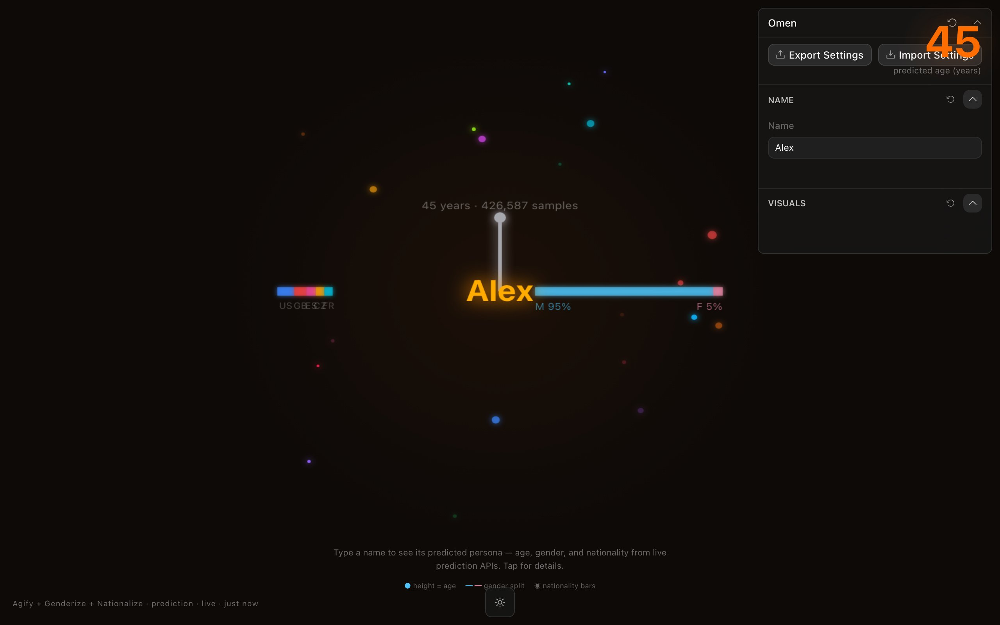

<div align="center">

<h1>Omen</h1>

<p><b>Type a first name, see who statistics expects.</b></p>

<p><i>Three free prediction APIs guess an age, a gender and a nationality from a name alone. Omen draws those guesses around the name in light.</i></p>

<h6>


</h6>

<a href="https://omen.parthchandak.info"><b>Live demo</b></a> ·
<a href="#how-it-works"><b>How it works</b></a> ·
<a href="#run-it"><b>Run it</b></a>

<br><br>

<a href="https://omen.parthchandak.info"></a>

<sub>Live capture for the default name "Alex", 22 October 2026. Real API responses.</sub>

</div>

<br>

Agify, Genderize and Nationalize each estimate one thing from a first name, based on how often
it appears with that age, gender or country in their datasets. Omen queries all three in
parallel as you type (after a 400 ms pause) and draws the answer as a small glowing chart
around the name. These are population statistics about a name, not facts about any person.

## How it works

| API | Field | Drawn as |
|---|---|---|
| [agify.io](https://agify.io) | `age`, `count` | Vertical bar above the name (0 to 90 years), its label, and the big number top-right |
| [genderize.io](https://genderize.io) | `gender`, `probability` | Horizontal bar to the right, split blue (M) and pink (F) |
| [nationalize.io](https://nationalize.io) | `country[]` | Stacked segments to the left, top five countries by probability |

Values ease from one name to the next instead of jumping. Click the canvas for a card listing
the predicted age with sample count, gender with confidence, and the top five nationalities. If
a request fails or times out after 5 seconds, the app shows built-in sample values for "Alex".

The free tier of these APIs allows a limited number of names per day per IP address; past that
they answer `429 Request limit reached`.

## Run it

```bash
git clone https://github.com/parthchandak02/omen.git
cd omen
npm install
npm run dev      # dev server on a free port
npm run build    # typecheck, then static site in dist/
```

No API keys are needed. The build is a static `dist/` folder, deployed to Cloudflare Pages.

<details>
<summary><b>Project layout</b></summary>

```
src/nameService.ts             Calls to the three APIs, fallback data, country colours
src/components/OmenCanvas.tsx  Canvas rendering, transitions, particles, detail card
src/routes/index.tsx           Page chrome: age readout, legend, data stamp
src/app/app-schema.ts          The Toolcraft controls panel
src/toolcraft/                 Toolcraft runtime and UI components
```

</details>

<details>
<summary><b>Known rough edges</b></summary>

- The Random button and the Particles and Aura Speed number inputs are declared in the schema
  but do not render in the panel.
- When the APIs are rate-limited the response is still treated as data: the canvas shows
  0 samples and an F 100% split, and the stamp still says `live`.
- The orbiting particles use a fixed set of colours, not the predicted countries.
- The top-right age readout overlaps the controls panel on desktop widths, and short country
  codes in the nationality stack can overlap.

</details>

<br>

<div align="center">
<sub>Built with React, Canvas 2D, Vite and Toolcraft. Data from Agify, Genderize and Nationalize.</sub>
</div>
