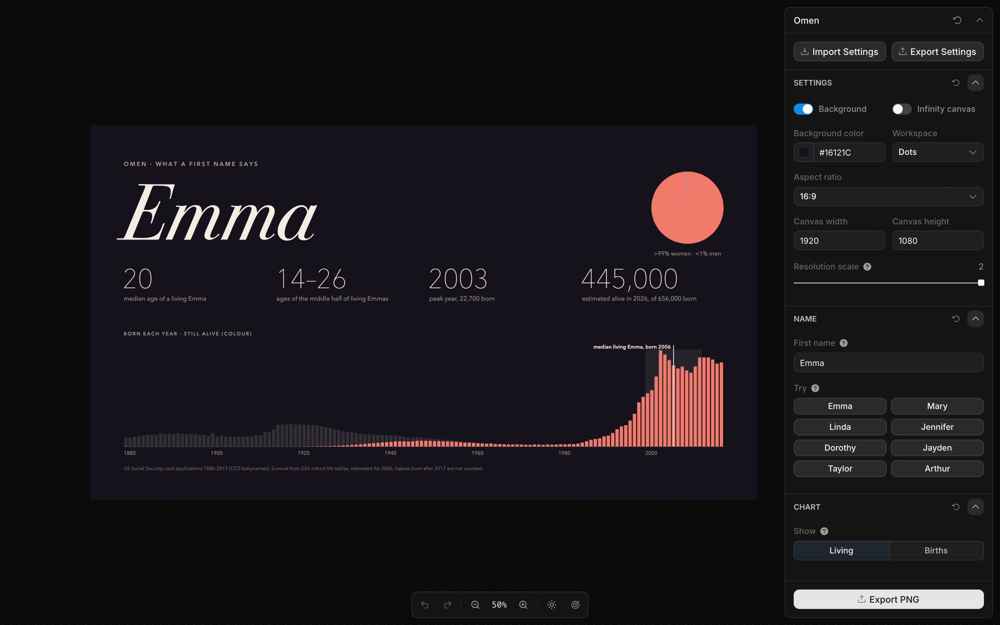

<div align="center">

<h1>Omen</h1>

<p><b>What a first name says about the people who have it.</b></p>

<p><i>Type any name and see, from a century of US birth records, how old its living owners probably are, how many are women and men, and when it peaked.</i></p>

<h6>


</h6>

<a href="https://omen.parthchandak.info"><b>Live app</b></a> ·
<a href="#how-it-works"><b>How it works</b></a> ·
<a href="#run-it"><b>Run it</b></a>

<br><br>

<a href="https://omen.parthchandak.info"></a>

<sub>The default poster: Emma, living view.</sub>

</div>

<br>

Omen turns a first name into a poster. The name is set large; a pie splits everyone given it
into women and men; four figures give the median age of a living holder, the ages of the middle
half, the peak year and how many are estimated alive of all born. The chart shows births for every
year from 1880 to 2017, with the estimated survivors coloured by sex, the middle half shaded and the
median marked, so a name like Dorothy reads as a grandmother's name and Jayden as a child's.

Type any first name or try one of eight with telling histories (Emma, Mary, Linda, Jennifer,
Dorothy, Jayden, Taylor, Arthur). Show switches the chart between survivors (Living) and every
birth (Births). Names given to fewer than 1,000 US babies between 1880 and 2017 get a plain note
instead of figures. The background can be changed (light colours flip the ink) or left out, and the
poster exports as PNG or JPG at 2K, 4K or 8K.

## How it works

The data is bundled, so there are no API calls or rate limits (the earlier version used Agify,
Genderize and Nationalize, which now allow 10 lookups a day). Births come from US Social Security
card applications 1880–2017 via the CC0 [`babynames`](https://github.com/hadley/babynames) package:
10,570 names with at least 1,000 births, one JSON file per first letter, loaded when first needed.
The share still alive in 2026 for each birth year and sex comes from the SSA cohort life tables in
the same package, interpolated between decades. `tools/build-name-data.py` rebuilds both. Babies
born after 2017 are not in the data, so young names read slightly older than they are.

The poster is drawn with Canvas 2D in a Web Worker at the exact zoomed backing resolution, and the
same drawing function renders the exported image. The editor shell, panel, settings import/export,
saved workspace and image export come from [Toolcraft](https://github.com/pixel-point/toolcraft)
(Pixel Point, MIT).

## Run it

```bash
git clone https://github.com/parthchandak02/omen.git
cd omen
npm install
npm run dev              # local editor; needs Node 22+
npm test                 # unit tests plus Toolcraft's contract checks
npm run verify:delivery  # full functional acceptance in a real browser
```

The live version is a static build (`npm run build`, then `dist/`) on Cloudflare Pages.

<details>
<summary><b>Project layout</b></summary>

```
public/data/names/*.json        Births per year by sex, one file per first letter
src/omen/survival.json          Share alive in 2026 per birth year and sex
src/omen/names-data.ts          Loading, caching and the age and sex statistics
src/omen/omen-draw.ts           Draws the whole poster; preview and export share it
src/omen/OmenCanvas.tsx         The live canvas: worker raster at the exact backing size
tools/build-name-data.py        Rebuilds the data from the babynames package
e2e/product-omen-*.spec.ts      Browser acceptance tests, one file per area
src/toolcraft/                  Vendored Toolcraft runtime (do not edit)
```

</details>

<br>

<div align="center">
<sub>Built with Toolcraft, React and Canvas 2D. Names from US Social Security records via babynames (CC0).</sub>
</div>
